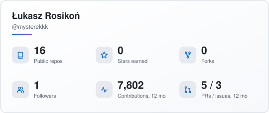
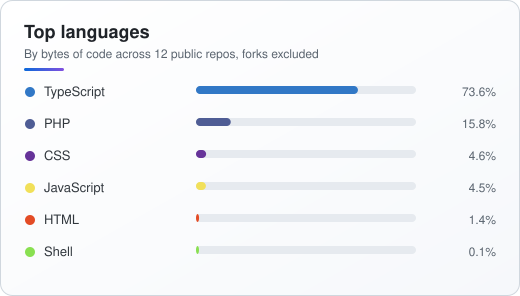
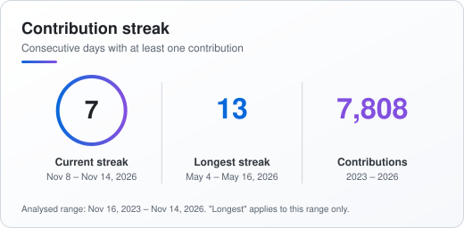

 

  <a href="#about">About</a> •
  <a href="#stack">Tech Stack</a> •
  <a href="#build">What I Build</a> •
  <a href="#projects">Projects</a> •
  <a href="#stats">Stats</a> •
  <a href="#studio">Studio</a> •
  <a href="#contact">Contact</a>

 

<h2 id="about">🧑‍💻 About Me</h2>

Senior Full-Stack Developer with hands-on experience designing and delivering scalable web applications from architecture to production. I run **[Luroweb.pl](https://luroweb.pl)** — a software studio building modern web products for businesses across Poland and Europe.

I bridge the gap between solid engineering and product thinking — combining deep technical expertise with strategic communication to deliver solutions that truly matter.

- 🔭 Currently building **AI-driven commerce & CRM platforms** for clients across e-learning, retail and services
- 🌱 Constantly refining **system architecture, DX and performance** across the stacks I ship
- 💬 Ask me about **React, NestJS, PHP, product architecture or scaling SaaS for real businesses**
- ⚡ Fun fact: every project at Luroweb goes from architecture to production under one roof

 

<h2 id="stack">🔧 Tech Stack</h2>

**Languages**
 

**Frontend**
 

**Backend**
 

**Data & Infra**
 

 

<h2 id="build">🏗️ What I Build</h2>

| | |
|---|---|
| 🧩 **Full-Stack Web Applications** | React + NestJS + PHP, end-to-end — from data model to deployed UI |
| 🛒 **E-Commerce Platforms** | Custom storefronts with scalable, maintainable backend solutions |
| 📊 **SaaS & Business Tools** | CRM, LMS and operations platforms tailored to real business needs |
| 🚀 **Performance & Architecture** | Optimizing for speed, scalability and developer experience |

 

<h2 id="projects">📌 Featured Projects</h2>

| Project | What it does |
|---|---|
| **[StatKiln](https://github.com/mysterekkk/statkiln)** | GitHub Action that bakes static SVG stat cards into your own repo — no image server, no hosting, no PAT. The cards above are generated by it |
| **[Web Image Compressor](https://github.com/mysterekkk/web-image-compressor)** | Free online image compressor & WebP converter — runs 100% in the browser, open source · [live demo](https://mysterekkk.github.io/web-image-compressor/) |
| **[Color Palette Studio](https://github.com/mysterekkk/color-palette-studio)** | Modern color palette generator — create, lock & export palettes, built with React + Vite · [live demo](https://mysterekkk.github.io/color-palette-studio/) |

> Most of my recent work (AI Commerce Hub, CRM/LMS platforms, custom e-commerce builds) ships under private client repositories through Luroweb — see the studio section below for the kind of systems I deliver.

 

<h2 id="stats">📊 GitHub Stats</h2>

<picture>
  <source media="(prefers-color-scheme: dark)" srcset="assets/statkiln/overview-dark.svg" />
  
</picture>
<picture>
  <source media="(prefers-color-scheme: dark)" srcset="assets/statkiln/languages-dark.svg" />
  
</picture>

<picture>
  <source media="(prefers-color-scheme: dark)" srcset="assets/statkiln/streak-dark.svg" />
  
</picture>

Cards baked daily into this repo by <a href="https://github.com/mysterekkk/statkiln">StatKiln</a> — no image server, no third-party uptime to depend on.

 

<picture>
  <source media="(prefers-color-scheme: dark)" srcset="https://raw.githubusercontent.com/mysterekkk/mysterekkk/output/github-contribution-grid-snake-dark.svg" />
  <source media="(prefers-color-scheme: light)" srcset="https://raw.githubusercontent.com/mysterekkk/mysterekkk/output/github-contribution-grid-snake.svg" />
  
</picture>

 

<h2 id="studio">🏢 Luroweb — My Software Studio</h2>

I run **[Luroweb.pl](https://luroweb.pl)**, a web development studio specializing in:

- 🌐 Modern websites & landing pages
- 🛒 E-commerce solutions
- 🛠️ Custom web applications & integrations
- 🚀 Performance optimization & technical consulting

 

<h2 id="contact">📬 Let's Connect</h2>

*Let's build something great together.*

  

